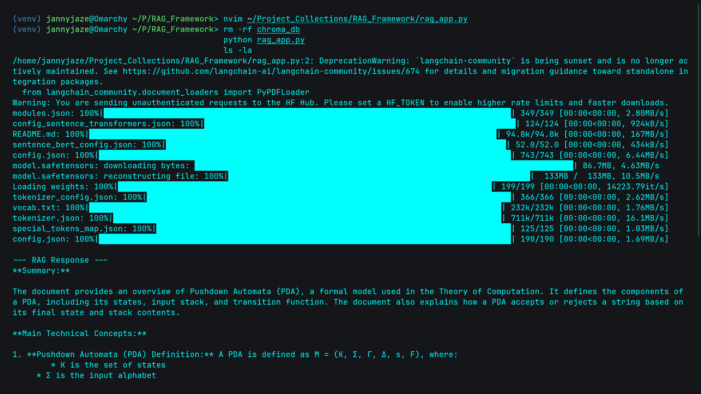
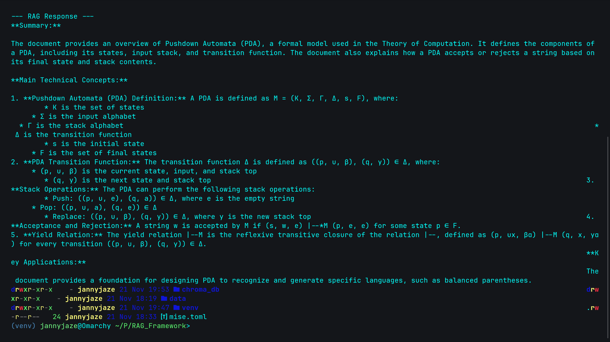

# Local RAG Pipeline with LangChain, ChromaDB, and Ollama

A modular Retrieval-Augmented Generation (RAG) pipeline built with **LangChain**, **ChromaDB**, **HuggingFace Embeddings**, and **Ollama (`llama3.1`)**. This system ingests a local PDF document, splits it into semantic chunks, stores vector embeddings in a persistent Chroma database, and answers user queries grounded strictly in the document's content.

---

## Architecture Overview

```text
PDF Document (./data/)
       │
       ▼
PyPDFLoader & RecursiveCharacterTextSplitter
       │
       ▼
HuggingFace Embeddings (BAAI/bge-small-en-v1.5)
       │
       ▼
ChromaDB Vector Store (./chroma_db/)
       │
       ▼
Retriever + Prompt Template + Ollama (llama3.1) ──▶ Grounded Response
```

---

## Project Structure

```text
RAG_Framework/
├── data/
│   └── document.pdf        # Input technical PDF document
├── chroma_db/              # Persisted ChromaDB vector store (git-ignored)
├── rag_app.py              # Main RAG pipeline script
├── mise.toml               # Local Python 3.12 version configuration
├── .gitignore              # Git ignore rules
└── README.md               # Project documentation
```

---

## Prerequisites

- **Python 3.12** (managed via `mise` or `venv`)
- **Ollama** running locally with `llama3.1` pulled:
  ```bash
  ollama pull llama3.1
  ```

---

## Setup & Usage

1. **Clone the repository:**
   ```bash
   git clone https://github.com/ChristianBuzarang/RAG_Framework.git
   cd RAG_Framework
   ```

2. **Create and activate a virtual environment:**
   ```bash
   python -m venv venv
   source venv/bin/activate.fish   # For Fish shell
   # source venv/bin/activate      # For Bash/Zsh
   ```

3. **Install dependencies:**
   ```bash
   pip install langchain langchain-community langchain-ollama langchain-huggingface sentence-transformers chromadb pypdf
   ```

4. **Add your PDF document:**
   Place your target PDF inside the `./data/` directory (e.g., `./data/document.pdf`) and ensure `PDF_PATH` in `rag_app.py` matches the filename.

5. **Run the RAG pipeline:**
   ```bash
   python rag_app.py
   ```

---

## Results & Screenshots

> **Tip:** Save your screenshots in an `assets/` or `screenshots/` folder in your repository (e.g., `screenshots/rag_output.png`) and update the image paths below.

### Terminal Execution & Local LLM Output


